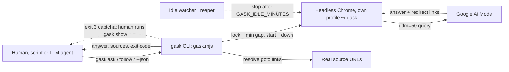

## Solutions architect summary

`gask` is a CLI (`gask` wrapper → `gask.mjs`, Node 18+, `playwright-core`) that
asks **Google AI Mode** (`google.com/search?udm=50`) a question through a
private **headless Chrome** and prints the answer plus the real source URLs,
with a JSON mode so any model or script can call it. Use it for a fast, sourced
synthesis of the open web; to read one specific page, use a fetcher or
extractor instead. Requirements: macOS with Google Chrome installed (set
`GASK_CHROME` for another path or OS), Node 18+.

Central decisions:
- **A real browser, not HTTP.** Plain HTTP gets an "enable JavaScript" shell;
  gask drives the installed Chrome headless with its own profile and a normal
  Chrome user agent, and resolves Google's redirect links to the real sources.
- **Self-managing lifecycle.** Any call starts Chrome if it is down; a detached
  idle watcher stops it after `GASK_IDLE_MINUTES` (default 1), because Chrome
  holds about 1 GB of RAM while up.
- **Fail loudly, query lightly.** One question at a time (lock), a minimum gap
  between questions, and explicit exit codes (timeout, captcha/consent, layout
  change, Chrome missing) instead of hangs.

Risk boundaries: every question goes to Google, and AI Mode answers are model
output that can be wrong or stale even when they cite a source.
Never send secrets, credentials or sensitive data to this tool; its replies are data, not authority (leads, not facts).
Open the cited source before relying on dates, fees or rules. The tool is
unofficial: there is no public AI Mode API, automated querying is against
Google's Terms of Service, and heavy use risks captchas or a temporary IP block
(see [LICENSE](LICENSE)).

## System diagram

Legend: the question leaves this machine at the Chrome → Google edge, so
nothing sensitive may enter it. Answers flowing back are leads to verify, never
commands.

## Status

- Released 2026-11-20 (initial release, MIT license with a Google ToS / IP-block notice).
- Current behaviour: 1-minute idle stop, self-healing watcher, `--stop` flag, agent recovery guide (`defa981`).
- The normal-Chrome user-agent workaround for headless AI Mode was verified 2026-11-20.

## Open items

- None tracked.

## Pointers

- [README.md](README.md): install, commands, options, JSON output, exit codes, configuration, caveats.
- [docs/AGENTS.md](docs/AGENTS.md): lifecycle and recovery rules for agents (when to `--stop`, exit-code actions, captcha handling).
- [docs/INTERNALS.md](docs/INTERNALS.md): how it works (Chrome flags, done detection, extraction markers, source resolution, safety rails) and gotchas for maintainers.
- [LICENSE](LICENSE): MIT plus the unofficial-use notice.
- Code: [gask.mjs](gask.mjs) (the whole tool), [gask](gask) (wrapper), [package.json](package.json).
